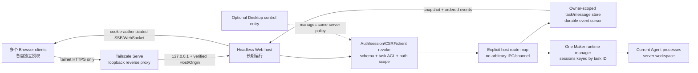

# Cindy Headless Web Server: 架构、授权与覆盖矩阵

> 状态：**active**。headless server 在 `feat/headless-server` worktree 已有源码纵向切片，并已完成本轮本地/真实浏览器/Tailnet 纵向联调；完整产品覆盖仍未完成。浏览器客户端已在 `apps/cindy-web-client` 实现。此文以源码为准，逐阶段记录事实；未端到端实现的矩阵项不得标为完成。
>
> **实施所有权（2026-11-04）**：headless server 实现由独立目标维护，拥有 `apps/cindy-headless/src/server/**` 与 `apps/cindy-headless/src/host.ts`；本目标不再编辑这些路径。浏览器客户端位于 `apps/cindy-web-client`，只依赖 [`web-client-headless-contract.md`](web-client-headless-contract.md) 的稳定 HTTP/SSE 契约。本文只作为跨目标的架构与覆盖台账，不替代 server 实现文档。

## 产品范围

- 一台 headless 服务器运行主人自己的 Cindy runtime 与一个同步任务空间。
- 多个手机/桌面浏览器是同一主人的独立授权客户端；它们共享任务数据与 Agent runtime，但各自有可撤销身份、会话和实时连接。
- 不设计多租户 SaaS、用户间任务隔离或每个浏览器独立 Agent。Tailscale ACL 是网络边界，Cindy 客户端批准/撤销仍是应用授权。
- Desktop 可作为后续入口管理同一 Web host/授权生命周期；Electron Desktop 不是 server 的启动依赖。
- headless 的行为必须服从 Cindy Maker/Agent 语义；benchmark `Profile` / Harbor artifact 不能被误称为 Cindy 完整任务产品模型。

## 源码审计与架构结论

### 现有 Headless 能复用什么

`apps/cindy-headless` 0.4.3 当前定位为容器/benchmark CLI。`src/host.ts:createHeadlessMaker()` 已提供可复用起点：构造 Claude Code/Codex/Pi `BaseAgent`、Maker Memory、MCP providers、`SqliteSessionStorage` 与 `Maker`。`maker-core` 支持 `Maker.createSession({ id, ... })` 的创建/恢复、`getSession`、`getSessionMeta`、`listActiveSessions`、`listAllMeta`、`Maker.on`；`Session` 支持事件/状态/交互订阅、send/steer/abort。

当前 `runTask()` 不能直接作为 server：每次调用建立隔离 HOME、创建一条 Session、收集一次性 trace/artifacts，完成后关闭 Maker/Storage 并删除临时 HOME；`SqliteSessionStorage` 只保存 `SessionMeta`，不存产品消息、持久输入队列、任务可见性/归档状态或事件游标。`host.ts` 的 `stateDir` 默认由输出目录派生，不能用作长期 server 数据根。它承载 benchmark 的冻结 Profile 和无人值守权限，不是完整用户会话服务。

Headless 的 `Profile` 当前固定单一 Agent backend/model/permission、工具路径和可选 container sandbox；Pi 只接受 `bypassPermissions`，因为现有 host 没有交互授权 UI。Web server 需要单独的 server config / task policy / durable service lifecycle，不能把每次任务的 benchmark profile 当成用户设置或扩展 benchmark capability catalog 代替产品接口。

### 不直接复用 Desktop Main

Desktop Maker host (`apps/desktop/src/main/maker-host/index.ts`) 与 `localDb`、Electron、IPC、账户/Provider、文件访问、任务输入队列、交互路由、插件、设备、SSH 和恢复 hooks 紧密接线。它是产品行为的对照来源，不是 headless import 的运行时依赖。Device Link relay 是设备互联协议服务；其 per-device relay 角色与浏览器用户授权不是同一个边界，也不提供 Headless runtime。

### 架构裁决

1. 在 `apps/cindy-headless` 增加明确的 server 命令与独立 server host 生命周期；评估后复用 `createHeadlessMaker` 的无 Electron Agent/Maker 组装，但把每次 run 的隔离 HOME、一次性产物、进程级环境覆写与 teardown 从常驻服务中拆开。
2. 一进程持有一个 owner-scoped `Maker`、一个长期 `stateDir`、一份持久任务/消息/队列存储及一个事件 journal。任务 runtime 仅由 server 按任务 ID 创建/恢复；浏览器连接只订阅/调用，不创建自己的 Maker。服务退出按有界顺序停止接入、处理发送事务、关闭 Session/Agent、flush 存储。
3. 增加显式 Host API 与前端 adapter。Main HTTP handler 不接受任意 channel/IPC 名称；每个 route 使用 runtime schema、server-owned task lookup、工作目录许可和 owner/client authorization。任务/消息 DTO、实时事件、排序与去重合同先成为 headless Host 的稳定契约，再由 Web 使用。
4. 同一个 owner 下面每台已批准浏览器有独立随机 client/session ID、可撤销 credential hash、过期与 scope；授权记录与 Cindy task workspace 共用同一 server owner，不能横向看到另一个账号。单主人模型不省略按客户端隔离：撤销客户端需立刻废止 cookie/session 和该客户端 WebSocket；关闭客户端不能停止 Agent。
5. 首次 owner bootstrap 由 server 控制台/本机 CLI 完成，不把 owner secret 放在 URL、日志或 HTML；浏览器通过短时配对请求，主人从已授权的管理会话/CLI 明确批准。cookie 为 HttpOnly、SameSite Strict、Secure (HTTPS)、随机不可推测；变更请求需 CSRF token；WebSocket 检查 Origin、Host、Cookie 与连接代次。所有拒绝与限速在 listener 内执行，不能将 Tailscale 身份头当作唯一应用授权。
6. Web host 默认绑定 `127.0.0.1`，不对 LAN/公网监听。Tailscale Serve 是单独可选的 tailnet reverse proxy：只有 `tailscale status` 与 `tailscale serve status --json` 确认在线、HTTPS FQDN 和本 app 自己的精确 route/target 后才公布 URL。Tailscale 官方 CLI 支持带 `--set-path` 的 Serve route 与同参数 `off`；实现只可对 Cindy 持有的、带稳定随机安装路径的 route 做创建/停用。启动前只读检查；路径已被不同 target 占用则拒绝接管；停用前复核 target 仍匹配，禁止 `serve reset`、覆盖根路径或清理别的用户 route。若 Tailscale 不可用或 API/CLI 版本不能安全核验，服务保持 loopback，并给出具体用户步骤与原因，不编造 URL。
7. Hosted user workspace root 由显式 server config 定义；每个 task 创建/打开均规范化并检查路径归属。Agent/工具访问文件时仍需判断执行位置与现有 permission mode；不得以浏览器上传的绝对路径授予本机访问。
8. 事件流通过每任务序号/owner generation 持久记录或可重建快照；重连携带 cursor，缺口时读 durable snapshot，再按稳定 event ID 去重。多 client 同时发消息/Stop/交互时使用 Host 级 task 生命周期/输入协调，确定操作顺序；只共享 Maker 单例并不自动解决消息并发、审批归属或事件 fanout。

### 请求与信任边界

Network reachability (Tailscale ACL) ≠ application authorization. Tailscale Serve loopback reverse proxy may attach identity headers, but Cindy still requires explicit client approval and revocation. Reject unknown Host/Origin, direct non-loopback listener ingress, malformed payloads, path traversal, unknown task IDs, revoked owner/client generation, and unsupported operation. No arbitrary HTTP proxy or channel forwarding.

## Desktop / Mobile / Web 功能覆盖矩阵

状态截至源码审计：浏览器客户端已有真实 UI/adapter（`apps/cindy-web-client`），但其依赖的 headless server 端仍由独立目标实现，契约见 [`web-client-headless-contract.md`](web-client-headless-contract.md)。因此“客户端已实现”不等于端到端可用；server 未实现时对应矩阵项仍不得标为完成。

| 功能域 | Desktop 权威实现/行为 | Mobile 现有远程路径 | Headless Web 状态、差异原因与后续 |
|---|---|---|---|
| Owner 登录与客户端授权 | `authManager` + `appSessionState`；Desktop 账号与本地 Profile | `AuthContext` + `DeviceLinkContext` 登录/设备目录；Device Link 被控授权 | 客户端已实现配对/等待/批准后建立会话的 UI 与 adapter；headless worktree 已实现配对、cookie、CSRF、client revoke（已实测纵向路径，见 integration-results）。单主人 bootstrap + 每客户端独立批准/撤销；Tailscale 身份只作来源证据。 |
| 当前在线服务与设备选择 | 单个 Electron Desktop 本机 host | Mobile 选择 online/control-enabled computer | 客户端只面向一个 server，并展示 `/api/session` 返回的真实 exposure 状态；headless worktree 已实现单 server/loopback 状态（已实测纵向路径，见 integration-results），不显示设备切换。后续 Desktop 作为可选同 owner 控制入口。 |
| 任务列表、分类、状态、归档 | `useCCSessions`、Desktop localDb session projection 和生命周期 handler | `HomeSurface` / `devices/[deviceId].tsx` 远端 projection | 客户端已实现任务列表、active/archived/all 过滤、cursor 分页“加载更多”与实时任务更新；headless worktree 已实现持久 task store、列表/创建/读取/归档（已实测纵向路径，见 integration-results），但尚无 Desktop 的完整项目/worktree/设备语义。 |
| 新建任务 | `NewMakerDraftRoute` + `maker:create-session` + Desktop project/worktree/device/default selection | `sessions/new.tsx` + `newSessionCreation.ts` | 客户端已实现标题、workspace、Agent/model/effort/permission 表单，选项来自 server capabilities；headless worktree 已实现单路由任务创建与 workspace root/符号链接校验（已实测纵向路径，见 integration-results）。 |
| 历史消息/任务打开 | `CCAgentSessionView` + localDb messages/media | `sessions/[sessionId].tsx` + remote history channels | 客户端已实现任务快照、消息列表、分页 adapter 与 cursor；headless worktree 已实现消息持久化与分页（已实测纵向路径，见 integration-results）。媒体历史仍未覆盖。 |
| 实时消息与工具事件 | Desktop `wireSessionToIpc()`、message persistence/broadcasters | Device Link `session:<id>` topic + `topics.ts` | 客户端已实现 SSE 订阅、`Last-Event-ID` 重连、message 去重、agent text/thinking 流式展示、reset 后快照恢复；headless worktree 已实现持久事件 journal 与 SSE（已实测纵向路径，见 integration-results）。多 client 并发排序仍未验证。 |
| 输入队列、发送、插话、停止、重试 | Desktop `AgentInputCoordinator` + durable queue snapshots + `sendToSessionInternal` | MobileMakerTransport `maker:input:*` | 客户端已实现发送与 Stop 的 UI/adapter，并发送稳定 `Idempotency-Key`；headless worktree 已实现同任务串行队列、幂等状态与 stop（已实测纵向路径，见 integration-results）。插话/队列编辑尚未做。 |
| 权限、AskUser、plan review 交互 | Desktop `interactionRouter.ts` + pending request/owner decisions | `InteractionPanel` + `maker:resolve-interaction` | Web permission / ask_user_question / plan_review 卡片与 resolve 已接通。真实 Claude `AskUserQuestion`：A/B 两浏览器收到卡片，B 回答后同一 turn 继续、双端卡片关闭；Codex permission 的 API allow once、真实浏览器 Deny 及本次真实 Tailnet permission 卡片也已通过。pending resolver 仅内存，重启后关闭；Pi 要求 `bypassPermissions`。 |
| Agent、模型、effort、Fast、权限选择 | Desktop catalog/provider credentials、`ChatInput`、default tuple 和 live controls | Mobile remote runtime/model handlers | 客户端新建表单已使用 server capabilities 的 Agent/model/effort/permission；运行中切换、Fast、供应商/凭证管理未实现。 |
| 附件、图片、媒体 | Desktop `ChatInput` + managed media stores / secure grants | Mobile attachment/Oss/peer file transport | 未实现。需要字节上传、大小/类型/路径绑定、媒体历史与回收；当前只发送文本。 |
| 工作目录文件读写 | `file-browser` + local/SSH/device-aware host | Mobile `file-browser:remote-op` | 未实现。客户端只提交 workspace 字符串；server 必须校验允许的根。 |
| 任务管理（rename/pin/archive/delete/fork/rewind） | Session lifecycle + Maker orchestrations + confirmations | Mobile task actions subset | 客户端已实现重命名与归档/恢复菜单；pin/delete/fork/rewind 未实现，server 端 delete/fork/rewind 未实现。 |
| Settings/供应商/MCP | Desktop `SettingsView` + owner/device settings, secrets host | Mobile 自身设置 + remote computer APIs | 未实现。客户端只显示 server 状态、语言与主题；凭证、供应商与 MCP 管理未做。 |
| 插件、MCP Apps、插件 market | Desktop plugin sandbox、MCP App iframe、capability approval | Mobile 仅部分插件命令展开/投影 | 未实现。MCP providers 可在 headless Maker 注入；Cindy plugin UI/runtime 无 headless 支持，需单独安全设计。 |
| 伙伴/私聊/群组 | Desktop bot and bot-group runtime/身份/专线 Session | Mobile bot/group screens and projections | 未实现。当前 Host 没有这些服务/数据模型；不能用普通 Maker task 冒充。 |
| 语音、麦克风、屏幕、键盘、Computer Use | Electron/OS permission and computer-use host | Mobile 自有语音/剪贴板及受控代输入 | 无同等 server 能力。Web permission 只能访问浏览器设备；服务端 OS 能力需单独远程代理与主人授权，否则显式限制。 |
| 原生文件对话框、shell、系统设置、窗口、菜单栏、通知 | Electron Main/OS integration | Mobile platform native API | 不复刻。Web 采用浏览器文件选择/页面通知等等价方式；仅服务端本机任务可执行能力由 headless host 定义。 |
| 服务生命周期、事件恢复、多浏览器 revoke | Electron lifecycle + Desktop app session invalidation | Mobile foreground/background and Device Link recovery | 客户端已实现断线重连/去重与 401 回到配对；headless worktree 已实现 server lifecycle、持久事件 journal、client revoke 与中断 turn 标记（已实测纵向路径，见 integration-results；含运行中 kill/restart 的 interrupted 标记）。 |
| Tailscale HTTPS | 仓库无集成；本次审计读 Tailscale official `serve`/`status` contract | 无 | 本轮已验证只读 Serve 核验、`ready` URL、HTTPS、`Secure` cookie、双 tailnet client、单端撤销和重启；只创建一个专用 path 并已删除，原 Serve 配置逐项核对未变。附件/媒体等仍缺。验收步骤见 [`web-client-local-integration.md`](web-client-local-integration.md) §9，实测结果见 [`web-client-integration-results.md`](web-client-integration-results.md)。 |

## 浏览器客户端实现（本目标）

- `apps/cindy-web-client/src/api.ts`：同源 fetch/SSE transport，cookie 由浏览器持有，CSRF 仅内存；`EventSource` 首连带 cursor，浏览器重连带 `Last-Event-ID`。
- `src/App.tsx`：认证状态机（加载/未授权/错误/已授权）、任务列表/过滤/分页/30s 刷新、任务快照与有界历史补页、SSE 合并去重与重连补偿、发送/停止、创建任务、401 回配对。
- `src/components/PairingView.tsx`：本机审批配对；requestId 只在页面与 API body 中出现，不写 URL/localStorage。
- `src/drafts.ts`：按任务保存未发送 composer 文本，并保存新任务表单草稿到 `sessionStorage`；发送/创建成功或 logout 时清除；不保存凭证。
- `src/components/Sidebar.tsx`、`TaskView.tsx`、`NewTaskView.tsx`、`InteractionPanel.tsx`、`ScopePanel.tsx`：桌面与手机宽度布局、任务工作区、消息流、流式文本、Stop、重命名/归档菜单、permission/ask_user/plan_review 卡片、显式 Web 能力/限制面板、创建表单、Tailscale 地址复制。
- `src/i18n.ts`：en / zh-CN / zh-TW / ja / ko / es / fr / de / pt-PT / pt-BR，古典中文映射到现代基底。
- `src/styles.css`：语义 token + Light/Dark + reduced motion；无硬编码主题色。
- 构建：`pnpm --filter @cindy/web-client build` 生成 `dist/index.html`、`app.js`、`app.css`；`stage --out <dir>` 生成带 SHA-256 的 manifest。server 按契约静态服务，不依赖 Electron。
- 本地联调：`scripts/dev-proxy.mjs` 仅在 `127.0.0.1` 托管 `dist` 并把 `/api/*` 转发到 loopback server；完整步骤见 [`web-client-local-integration.md`](web-client-local-integration.md)。Tailscale 不是本地 smoke 的前置条件。
- 端到端仍待 server 目标实现契约；客户端不包含 mock 数据或假认证。

## 实施阶段与完成门槛

### 0. 服务器化基础 (active)

- 新 server CLI lifecycle 与独立配置/data root，不改变 `run` benchmark 命令语义或产物。
- 一个长期 Maker runtime manager，持久 session/message/task metadata，明确任务恢复、关闭和 server restart 语义。
- 单 owner bootstrap 和 client registry；端侧授权、撤销、超时、并发隔离行为确定。
- 明确执行端路径、容器/permission policy、secret delivery、MCP/Agent operation 限制。

### 1. 安全 Web 与任务核心

- 客户端已完成独立 React Web entry、cookie/CSRF adapter、任务列表/创建/打开/发送/停止/实时事件/重连去重、桌面与窄屏布局、Light/Dark 与支持语言；Host/Origin、会话签发与撤权由 server 强制。
- **server 端当前状态**：headless worktree 已有 cookie/CSRF、client session/revoke、durable store、SSE journal 的源码；仍缺受信 tailnet Host/Origin/HTTPS 判定、交互端点、静态托管（临时由 dev proxy 替代）和真实运行验收。完成这些并通过验收后才能把本阶段标为端到端完成。

### 2. Tailscale exposure

- listener loopback only; Serve route unique persisted installation path; exact before/after status validation; only disable route if path and target still match Cindy ownership; never reset/replace unrelated routes.
- HTTPS FQDN only displayed after active route + status proves actual route to this local port; failure messages distinguish CLI absent, Tailscale offline, HTTPS unavailable, route conflict, hostname missing and status unparseable.
- Browser hostname/Origin checks include verified `*.ts.net` host and request came through allowed proxy; no direct LAN/public binding.

### 3. Desktop/Mobile parity expansion

Follow the matrix by user workflow. Every unsupported capability remains visible in Web and explained; plugins, bots/groups, media/file handling, model management, and OS integrations remain separate acceptance slices.

## Verification restrictions

The active goal forbids tests/test commands, product/server startup, listener exposure, deployment, package installation, Tailscale configuration changes, and commit/push. Do only source review and permitted static checks. Do not claim runtime/network/real browser/Tailscale checks passed. These remain explicit user-authorized acceptance scenarios after implementation is complete.
